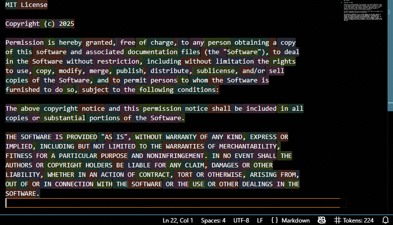

# Local Token Visualizer

Local Token Visualizer is a VS Code extension for counting and visualizing LLM tokens offline with a local Hugging Face tokenizer directory.



## What It Does

- Counts tokens for the active editor and highlights each token range with a five-color overlay.
- Works out of the box with built-in OpenAI and Google tokenizers, and downloads others on request.
- Counts tokens locally. Nothing in your editor is ever sent anywhere.
- Updates immediately for smaller files and debounces larger files.

## Choosing a Tokenizer

Click the **Tokens** status bar item when it says *Select tokenizer*, hover it and choose **Change tokenizer…**, or run **Local Token Visualizer: Select Tokenizer** from the Command Palette. Pick from the list; no paths to copy.

| Tokenizer | For | Where it comes from |
| --- | --- | --- |
| GPT-4o / o-series (`o200k_base`) | GPT-4o, GPT-4.1, o1, o3 | Built in (default) |
| gpt-oss (`o200k_harmony`) | gpt-oss, Harmony chat format | Built in |
| Gemma 4 | Gemma 4 (closest public match to Gemini) | Built in |
| GPT-4 / GPT-3.5 (`cl100k_base`) | GPT-4, GPT-3.5 Turbo, embeddings v3 | Download |
| Llama 3.1, Qwen 2.5, DeepSeek V3, Mistral v3 | Those model families | Download |
| Any Hugging Face repo | Anything with a `tokenizer.json` | **Enter a Hugging Face model ID…** |
| A folder on disk | Your own tokenizer | **Use a local folder…** |

Notes on accuracy:

- **Claude:** Anthropic has not published the tokenizer for Claude 3 and newer, and the old Claude 1/2 tokenizer is not close enough to be useful, so none is included. Use Anthropic's token counting API for exact Claude numbers.
- **Gemini:** Google has not published Gemini's tokenizer. Gemma 4 is the closest public one, so Gemini counts are approximate.
- Counts cover the text itself. Special tokens that a model adds on its own, such as a BOS token, are not counted.

### Downloads

Choosing a tokenizer marked *download* fetches `tokenizer.json` (and `tokenizer_config.json` when present) once from huggingface.co, at a pinned commit for the listed ones, and stores it in the extension's storage folder. After that it works offline. This is the only network access the extension makes, and it only happens when you pick a download. Gated repositories (ones that require accepting a license on huggingface.co) cannot be downloaded anonymously; accept the license, download `tokenizer.json` yourself, and use **Use a local folder…**.

## Controls

| Control | Action |
| --- | --- |
| Status bar `Tokens: N` | Click to toggle token highlighting. Hover for the active tokenizer and a *Change tokenizer…* link. |
| `Local Token Visualizer: Select Tokenizer` | Opens the tokenizer menu. |
| `Local Token Visualizer: Use Local Tokenizer Folder` | Opens a folder picker and saves `localTokenizer.modelPath`. |
| `Local Token Visualizer: Toggle Highlighting` | Toggles `localTokenizer.enableHighlighting`. |

When highlighting is off, the status bar shows `Tokens: N (highlight off)`.

## Settings

| Setting | Default | Description |
| --- | --- | --- |
| `localTokenizer.model` | `gpt-4o` | Tokenizer chosen from the menu: a catalog id (`gpt-4o`, `o200k-harmony`, `gemma-4`, `gpt-4`, `llama-3`, `qwen-2.5`, `deepseek-v3`, `mistral-v3`) or any Hugging Face repo id such as `Qwen/Qwen2.5-0.5B`. |
| `localTokenizer.modelPath` | empty | Optional. A local folder containing `tokenizer.json`. Overrides `localTokenizer.model` when set. |
| `localTokenizer.enableHighlighting` | `true` | Enables or disables token overlay highlighting. |
| `localTokenizer.smallFileThreshold` | `50000` | Files below this character count update immediately instead of waiting for debounce. |

## Development

```bash
npm ci
npm run fetch-tokenizers   # downloads the built-in tokenizers (pinned commits, SHA-256 verified)
npm test                   # runs fetch-tokenizers first, then the unit and integration tests
npm run package            # builds the VSIX
```

`src/catalog.json` lists every tokenizer, the Hugging Face commit it is pinned to, and, for built-in ones, a checksum. To change the built-in set, edit that file and run `node scripts/fetch-tokenizers.mjs --all` to try any entry. Only tokenizers with a permissive license (MIT or Apache-2.0) should be built in; others stay download-only so they are fetched by the user directly from Hugging Face.

## Package Size Notes

The extension uses `@huggingface/tokenizers`, a zero-dependency, pure JavaScript tokenizer, and ships as a single esbuild bundle (`dist/extension.js`). No `node_modules` or native runtimes are packaged. Almost all of the VSIX is the three built-in `tokenizer.json` files (about 13 MB compressed in total); everything else is under 0.5 MB.
